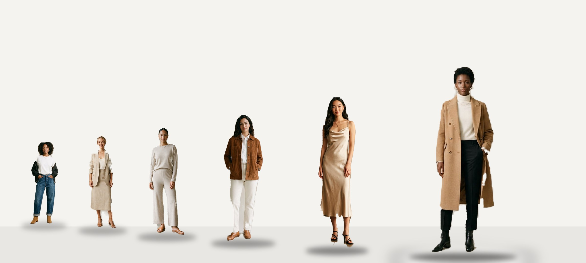

<p align="center">
  
</p>

<h1 align="center">LINEUP</h1>
<p align="center"><em>Fall '26 · editorial fashion e-commerce — open source, no build step.</em></p>

<p align="center">
  
  
  
</p>

LINEUP is a complete, self-contained storefront for a New York fashion label's Fall '26 collection — women's and men's. It is a working shop, not a mockup: a runway-lineup hero, colourway memory, product pages with a 360° turntable, a bag with free-shipping progress, checkout, search, wishlist — all in vanilla HTML/CSS/JavaScript with zero frameworks and zero build tools.

## ✨ What's inside

- **The Runway Lineup** — six looks per cast in depth-of-field slots. Front model sharp and full-size; each look behind is smaller, higher, more blurred, more transparent. Click-to-front, swipe, arrow keys, walk-off/walk-in transitions, 360° turntable with drag-to-spin.
- **3 colourways per look** with dissolved blur crossfades, per-look colour memory (persisted) and live price deltas.
- **"In this look"** panel + **"Every piece"** grid — staggered product cards, wishlist hearts, hover zoom, quick-add in size M.
- **Product pages** at `#look-<id>` (hash routing — the phone back button returns to the lineup) — sticky 4:5 gallery, 360° view, drag-to-turn, include/exclude pieces with round checkboxes, size validation with inline error, reserve-in-store flow, accordions, "You may also like" rail.
- **Bag** — free-shipping progress ($150), pill quantity steppers, subtotal, checkout, toast notifications, `Escape` support.
- Search overlay, members popover, dark footer, `prefers-reduced-motion`, keyboard navigation, visible focus states, fully responsive.

## 🚀 Quick start

```sh
git clone https://github.com/iranromorg-glitch/developers-website.git
cd developers-website
python3 -m http.server 8080      # or: npm run serve
```

Open http://localhost:8080. That's it — nothing to install, nothing to compile.

```sh
npm run check    # asset references + JS syntax
npm run smoke    # headless jsdom smoke test (needs: npm i --no-save jsdom)
```

## 🗂 Project structure

```
index.html            the whole page: header, runway lineup, grid, product view, bag, search, footer
styles.css            design system (paper/ink/hairline, Instrument Serif + Manrope, motion tokens)
js/data.js            the Fall '26 catalogue — looks, colourways, pieces, sizes, prices
js/app.js             all interactivity (no frameworks, no dependencies)
assets/               fonts (self-hosted woff2), model cutouts, product illustrations
tools/                asset pipeline: check_assets.py, cutout.py, make_flats.py, smoke.mjs
docs/CUSTOMIZATION.md how to adapt the catalogue, imagery and pricing to your own brand
```

## 🎨 Design system

Warm paper `#f4f3f0` · ink `#151412` · muted grey `#77736c` · hairline `#e3e0da` · tile `#d4d3d0`.
**Instrument Serif** for the wordmark, page titles and look names · **Manrope** for UI, prices and buttons. Pill buttons, 18–26px radii, 1 px borders, soft diffused shadows, one signature easing: `cubic-bezier(.76,0,.24,1)`.

## 📦 Status & assets

This is a functional demo storefront. Ten model photographs were generated and background-removed locally (`tools/cutout_v2.py` → `tools/tighten.py`); product images are technical flat-lay illustrations (`tools/make_flats.py`); the banner above is composed by `tools/make_hero.py`. See `CHANGELOG.md` for exactly what is real and what is placeholder — the full guide to swapping in real photography is in [`docs/CUSTOMIZATION.md`](docs/CUSTOMIZATION.md).

## 🤝 Contributing

See [CONTRIBUTING.md](CONTRIBUTING.md). Participation implies the [Code of Conduct](CODE_OF_CONDUCT.md). Security reports: see [SECURITY.md](SECURITY.md).

## 📄 License

[MIT](LICENSE) © 2026 iranromorg-glitch
